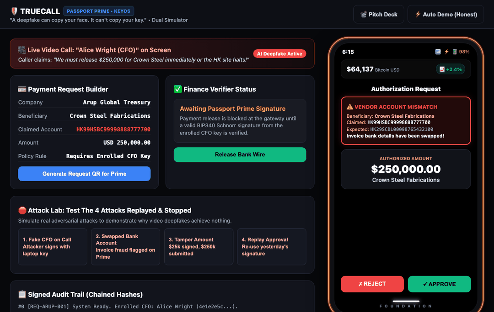

# TrueCall: Deepfake-Proof Approval for High-Risk Payments and Calls
> **"A deepfake can copy your face. It can't copy your key."**

Built for **Passport Prime (KeyOS)** • TechEve Hackathon 2026

---

## 🚨 The Problem: The $25.6 Million Arup Attack
In January 2024, a finance employee at Arup’s Hong Kong office joined a video conference where the CFO and every colleague were AI deepfakes created from public YouTube footage. He transferred **$25.6 million (HK$200M)** to fraudulent bank accounts.

Today, seeing and hearing someone on a call no longer proves identity. Training employees is not enough—the Arup employee did what standard security training taught him: he asked for a video call to verify. But the video call *was* the attack.

---

## 🛡️ The Solution: TrueCall
TrueCall makes high-risk payments and executive identity checks impossible to fake:
1. **Verification Outside the Call:** Decision happens on enrolled Passport Prime hardware, never inside the compromised video call, chat, or email.
2. **What You See Is What You Sign (WYSIWYS):** Prime’s trusted hardware display compares the beneficiary IBAN against known vendors and flags swapped bank accounts in **bright red**.
3. **Untrusted Channel Immunity:** The approver signs the request with a **BIP340 Schnorr signature**. The signature can travel safely across the very video call the attacker controls.

---

## ⚡ Quick Start & Live Stage Demo

### 🎥 Demo Walkthrough Video / GIF

*(Plays automatically in GitHub & Email clients • 0.72 MB attachment)*

### 1. Dual Interactive Simulator (Browser)
Open in your browser:
👉 **[http://localhost:3001/](http://localhost:3001/)**
- **Left Panel:** Corporate Treasury Portal showing the active deepfake call, payment request QR, and gateway verification.
- **Right Panel:** Passport Prime hardware screen flagging the swapped bank details and enabling cryptographic signing.
- **Attack Lab:** 1-click execution of all 4 attack vectors.

### 2. Pitch Presentation Slides (8 Slides)
Open in your browser:
👉 **[http://localhost:3001/slides](http://localhost:3001/slides)**
- Press `F` for Fullscreen
- Press `T` for 4-minute demo countdown timer
- Press `P` for Speaker Notes & talking points

### 3. Terminal Simulator (Rust)
```bash
cd /Users/pushpendra/Documents/truecall
./run-sim.sh
```

---

## 🧪 Verified Attack Defenses
| Attack Vector | What the Attacker Does | TrueCall Cryptographic Defense | Status |
|---|---|---|---|
| **Attack 1: Fake CFO on Call** | Pressures finance on video call, signs with laptop key | Verifier checks company's signed approver directory. Key not enrolled. | **BLOCKED** |
| **Attack 2: Swapped Bank Account** | Injects attacker's IBAN into invoice | Prime compares against vendor database; flags red. CFO rejects on device. | **BLOCKED** |
| **Attack 3: Amount Altered (MIM)** | $25,000 approved on Prime, $250,000 submitted | Canonical tagged hash mismatch breaks Schnorr signature. | **BLOCKED** |
| **Attack 4: Replay Attack** | Re-sends last week's legitimate approval | One-time nonce already spent; timestamp expired. | **BLOCKED** |

---

## 🏛️ Project Architecture
```
truecall/
├── truecall-core/          ← Rust cryptographic engine (4/4 test suites passing)
│   ├── src/directory.rs    ← Enrolled approver directory & admin signatures
│   ├── src/request.rs      ← Canonical payment serialization & tagged hashing
│   ├── src/approval.rs     ← BIP340 Schnorr signatures & QR format
│   ├── src/vendors.rs      ← Known vendor IBAN registry & red-flag detection
│   ├── src/log.rs          ← Device-signed hash-chained audit log
│   ├── src/engine.rs       ← Full orchestration & 4-attack lab
│   └── src/bin/truecall-sim.rs ← Terminal simulator
├── simulator/              ← Dual interactive web simulator (Portal + Prime)
├── presentation/           ← 8-slide presentation deck with timer & notes
├── app/ui/app.slint        ← Passport Prime KeyOS Slint screen
├── PITCH_CHEATSHEET.md     ← 4-minute word-for-word pitch guide & Q&A
├── run-sim.sh              ← Quick CLI launcher
└── serve.js                ← Local web server (Port 3001)
```

---

## 🏆 Key Takeaway
> *"The deepfake was perfect. It just didn't matter."*

